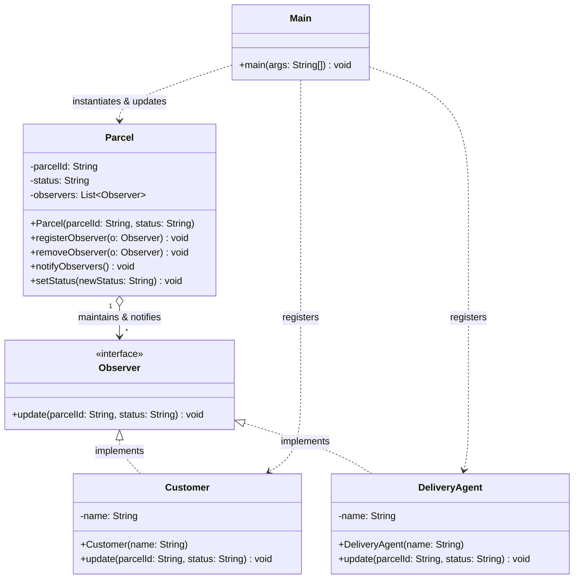
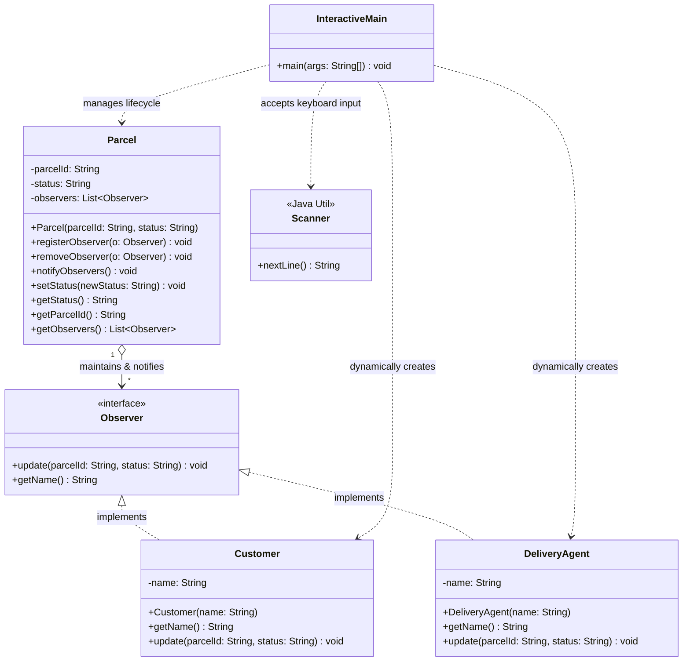
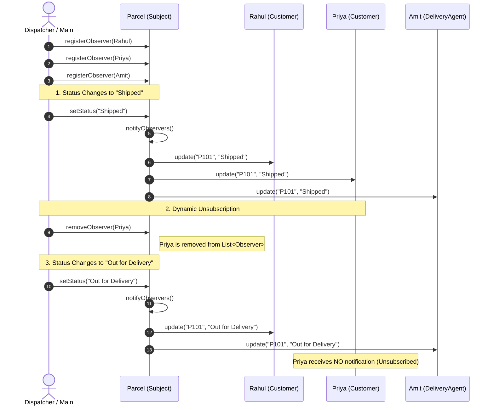

# Smart Parcel Tracking and Notification System Using Observer Design Pattern in Java

A college mini project demonstrating the **Observer Design Pattern** in Java, featuring an unmodified core Java implementation, an interactive user-input console edition, and a modern real-time **blue-and-white** web tracking portal.

---

## 📋 1. Problem Statement

### Background
In contemporary e-commerce and logistics networks, a parcel travels through several sequential fulfillment stages—such as **Packed**, **Shipped**, **Out for Delivery**, and **Delivered**. Diverse stakeholders need instantaneous, tailored alerts whenever a parcel's status transitions:
- **Customers** require reassuring alerts containing their parcel ID and delivery progress.
- **Delivery Agents** require action-oriented dispatches to plan final-mile dropoffs.
- Stakeholders must also have the freedom to **subscribe or unsubscribe** dynamically at any point during transit without disrupting the system.

### The Problem of Tight Coupling
In a naive software implementation, the `Parcel` class directly references concrete `Customer` and `DeliveryAgent` objects. This introduces critical architectural problems:
1. **Tight Coupling**: Any change in the notification logic or customer structure breaks the `Parcel` class.
2. **Violation of the Open-Closed Principle (OCP)**: Adding new observers (e.g., `WarehouseManager`, `SmsNotificationService`, or `AnalyticsTracker`) forces modifications to the core `Parcel` class.
3. **Rigid Subscriptions**: Hardcoded dependencies prevent observers from dynamically subscribing or opting out at runtime.

### Proposed Solution
By implementing the **Observer Design Pattern (GoF Behavioral Pattern)**:
- The **Subject** (`Parcel`) maintains a dynamic list of subscribers adhering to an abstract `Observer` interface.
- Concrete observers (`Customer` and `DeliveryAgent`) register with the subject via `registerObserver()`.
- When `setStatus()` detects a state change, `notifyObservers()` automatically iterates through the active registry and invokes `update()`.
- Observers can dynamically opt out via `removeObserver()`, ensuring that un-subscribed parties receive zero subsequent notifications.

---

## 📊 2. UML Diagrams

### A. UML Class Diagram — `Main.java` (Original Unedited Core)



---

### B. UML Class Diagram — `InteractiveMain.java` (User Input with Scanner)



---

### C. UML Sequence Diagram — Dynamic Notification & Unsubscribe Flow



---

## 📐 3. Observer Design Pattern Mapping

| Pattern Participant | Java Component | Role & Responsibility |
| :--- | :--- | :--- |
| **Observer Interface** | `interface Observer` | Declares the notification contract: `void update(String parcelId, String status)`. |
| **Concrete Observer 1** | `class Customer` | Implements `update()` to print customer-tailored status alerts: `"Hello <name>! Your parcel <id> is now: <status>"`. |
| **Concrete Observer 2** | `class DeliveryAgent` | Implements `update()` to print courier-tailored status alerts: `"Agent <name>: Parcel <id> status updated to: <status>"`. |
| **Concrete Subject** | `class Parcel` | Maintains internal state (`parcelId`, `status`) and observer registry (`List<Observer> observers`). Exposes `registerObserver()`, `removeObserver()`, `notifyObservers()`, and `setStatus()`. |
| **Client / Driver** | `public class Main` / `InteractiveMain` | Drives the state transitions, registers/removes observers, and triggers automated notifications. |

---

## 🚀 4. How to Run the Project

### Option A: Web Application (Real-Time Tracking & Dispatch Dashboard)

1. Open PowerShell or Command Prompt in this folder:
   ```bash
   node server.js
   ```
   *(Or simply double-click **`run.bat`**)*

2. Open your web browser at:
   ```
   http://localhost:3000
   ```

3. **Features on the Web**:
   - Multi-consignment support (`#P101 - Rahul`, `#P102 - Priya`, `#P103 - Sneha`).
   - One-click dispatch buttons (`Packed`, `Shipped`, `Out for Delivery`, `Delivered`).
   - Live notification feed with customer vs. delivery agent message badges.
   - Dynamic subscriber management (add custom observers or click "Unsubscribe").
   - `+ New Parcel` registration modal.

---

### Option B: Interactive Console Program with User Input (`InteractiveMain.java`)

Allows the student or professor to dynamically type custom parcel IDs, add observers, change statuses, and unsubscribe observers directly from the keyboard:

```bash
javac InteractiveMain.java
java InteractiveMain
```
*(Or simply double-click **`interactive_run.bat`**)*

---

### Option C: Original Pure Java Console (`Main.java`)

Runs the original unedited Java Observer demonstration:

```bash
javac Main.java
java Main
```
*(Or double-click **`run_java_only.bat`**)*

#### Exact Console Output Produced:
```text
--- Status updated to Shipped ---
Hello Rahul! Your parcel P101 is now: Shipped
Hello Priya! Your parcel P101 is now: Shipped
Agent Amit: Parcel P101 status updated to: Shipped

--- Priya unsubscribes ---

--- Status updated to Out for Delivery ---
Hello Rahul! Your parcel P101 is now: Out for Delivery
Agent Amit: Parcel P101 status updated to: Out for Delivery
```

---

## 🎓 5. College Viva Defense Notes

1. **What is Loose Coupling?**
   - The Subject (`Parcel`) only interacts through the abstract `Observer` interface. It has zero dependencies on concrete observer implementations.

2. **How does this satisfy the Open-Closed Principle (OCP)?**
   - New notification targets (e.g. `EmailService`, `WarehouseManager`, `SmsGateway`) can be created simply by implementing `Observer`, without changing even one line of the `Parcel` class.

3. **Why did Priya stop receiving notifications?**
   - In `Main.java`, `parcel.removeObserver(priya)` removed her reference from the `List<Observer>`. When `setStatus("Out for Delivery")` called `notifyObservers()`, only active subscribers (`Rahul` and `Amit`) were updated.
